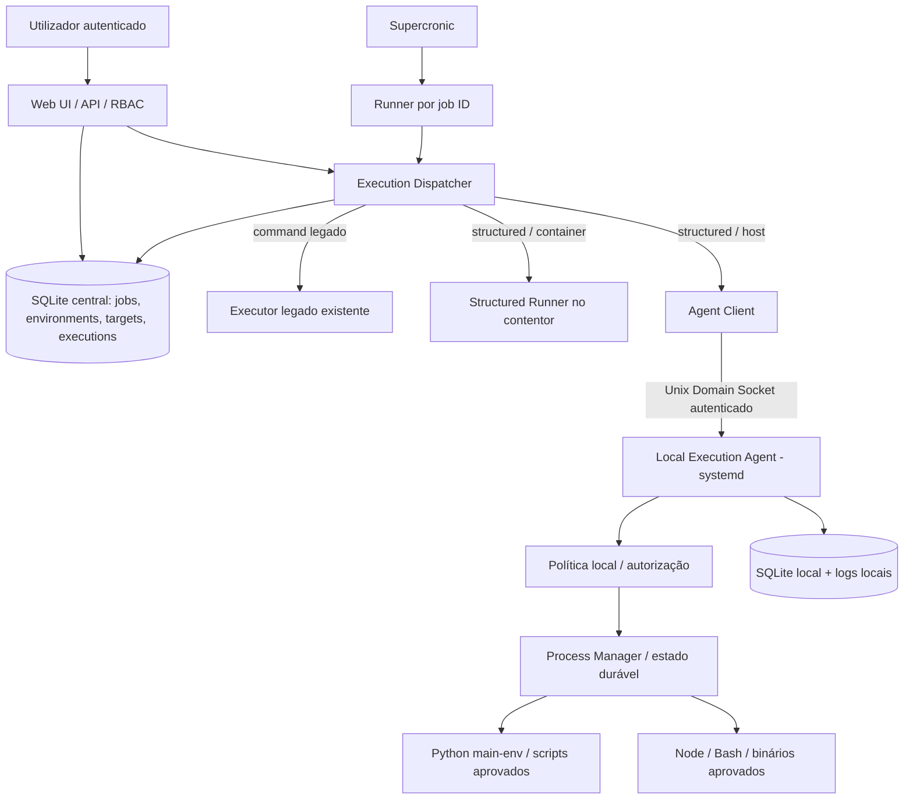

# Crontab UI v0.7.0 — Especificação de implementação

**Título:** Execution Environments, Structured Tasks & Secure Local Execution Agent  
**Tipo:** SDD / PRD técnico / instruções para agente de desenvolvimento  
**Versão do documento:** 1.0 — proposta  
**Idioma de implementação e documentação:** português europeu (PT-PT)  
**Base funcional:** Crontab UI v0.6.3  
**Repositório:** https://github.com/Kowts/crontab-ui  
**Estado:** para revisão e implementação incremental; não implica código já implementado

---

## 0. Instruções obrigatórias para a IA implementadora

1. Inspeccionar **o repositório e a branch actual** antes de alterar código. Este documento descreve a base v0.6.3 observada em 13/11/2026; confirmar ficheiros, funções, API, modelo de dados, testes, scripts de CI e convenções actuais. Não presumir que os exemplos são interfaces existentes.
2. Implementar por etapas pequenas, com testes e commits separados. Não fazer uma reescrita global da aplicação.
3. Preservar integralmente tarefas `command`, agendamentos, execução manual, histórico, mailing, backups, auditoria, RBAC, Supercronic e modo de deployment conjunto. O agente no host é **opcional**: a aplicação deve funcionar sem ele.
4. Não alterar nem substituir o mecanismo de execução legado sem testes de regressão. O modo estruturado deve ter um caminho de execução **sem shell**.
5. Não expor Docker socket, SSH genérico, root, host PID namespace, `--privileged`, montagem de `/` ou execução remota de comandos arbitrários.
6. Tratar o agente como fronteira de confiança. A autorização do utilizador na UI não substitui a política independente do agente.
7. Não instalar Python, criar venvs, gerir dependências, executar pipelines visuais nem suportar agentes remotos nesta versão.
8. Não fazer deploy nem publicar release/tag sem aprovação explícita. Nunca executar scripts ETL de produção ou argumentos destrutivos em testes.
9. Não declarar testes aprovados sem os executar e apresentar resultados. Não declarar CI verde sem verificar o run correspondente ao SHA.
10. Documentar decisões não resolvidas antes de implementar mecanismos de segurança. Usar a secção **Decisões e bloqueios** como gate técnico.

## 1. Contexto e problema

Hoje é possível agendar comandos no Crontab UI, mas um processo Python depende de um caminho de interpretador incluído manualmente no comando. Exemplo ilustrativo:

```bash
/opt/etl-processes/main-env/bin/python /opt/etl-processes/pagamentos-siebel/main.py --date 2026-11 --delete
```

Objectivo: registar uma vez o ambiente `Python ETL — Principal` com o executável `/opt/etl-processes/main-env/bin/python`; ao criar uma tarefa, escolher esse ambiente, o ficheiro `.py`, o directório de trabalho, os argumentos e a expressão cron. O mesmo conceito deve funcionar com Node.js, Bash e binários aprovados.

**Restrição crítica:** o Crontab UI actual corre num contentor Node.js Alpine; um venv Python no Ubuntu host não está automaticamente acessível dentro desse contentor. Montar apenas o directório do venv no contentor não garante compatibilidade (bibliotecas, paths, ABI, dependências nativas). Para o caso real é necessário um executor no host, com políticas restritivas.

### 1.1 Resultados esperados

- Catálogo reutilizável de ambientes de execução por destino.
- Formulário administrativo para criar, validar, actualizar, activar/desactivar ambientes.
- Tarefas estruturadas com argumentos em array, sem interpretação de shell.
- Execução manual e agendada pela mesma cadeia de despacho.
- Agente Ubuntu local, instalado como serviço systemd, sem API pública.
- Execuções rastreáveis, canceláveis e recuperáveis, com logs e resultados integrados.
- Retrocompatibilidade com a v0.6.3 e instalação sem agente.

### 1.2 Fora do âmbito

Execução em múltiplos hosts remotos, SSH, Kubernetes, criação/instalação de ambientes virtuais, gestão de pacotes, secrets vault próprio, workflow DAG, editor de código, descoberta automática de todos os executáveis do host, sandbox de código não fiável, execução com privilégios de root e alteração de pipelines ETL existentes.

## 2. Factos observados no código v0.6.3 e pontos de integração

Verificar novamente na branch de implementação:

| Ficheiro | Observação | Consequência |
|---|---|---|
| `crontab.js` | `makeCommand()` agenda `bin/crontab-ui-runner.js` por ID de tarefa; SQLite e Supercronic existentes | Manter comando agendado por ID, não colocar argumentos/segredos na crontab |
| `bin/crontab-ui-runner.js` | Valida ID e chama `crontab.runjob()` | Manter entrada única para tarefas agendadas |
| `execution.js` | Execução legada usa shell e inclui cancelamento, timeout e limites | Preservar; criar executor estruturado distinto, partilhando contratos testados |
| `config/execution-states.js` | Estados `pending`, `running`, `completed`, `failed`, `timeout`, `cancelled`, `interrupted`, `output_limit` e transições | Reutilizar nomes e semântica; modelar falhas de despacho separadamente |
| `lib/database.js` | SQLite `better-sqlite3`, `jobs` com documento JSON, `executions`, `manual_runs`, `sessions` | Criar migrações versionadas e novas tabelas sem corromper backups |
| `scheduler.js` | Supercronic e recuperação de agenda | Não introduzir segundo scheduler |
| `docker-compose.yml` | Contentor sem acesso ao Python host; volume de dados persistente | Agente fora do contentor; acesso mínimo ao socket |
| `supervisord.conf` | Web e scheduler no contentor | Não iniciar agente host no Supervisor do contentor |
| `package.json` | Node.js e Vitest/ESLint | Reutilizar convenções e tooling do projecto |

**Nota:** as novas rotas, tabelas e nomes de módulos abaixo são **propostas**, não funcionalidades já existentes.

## 3. Arquitectura-alvo



### 3.1 Componentes

**Web/API:** gere catálogo, permissões, validações, dependências e edição de tarefas. Não executa comandos arbitrários no host.

**Dispatcher:** resolve a tarefa e o ambiente; cria operação idempotente; escolhe execução legada, estruturada no contentor ou estruturada no host; mantém estados e auditoria.

**Structured Runner:** `spawn(executable, argv, { shell:false })` para executáveis presentes no contentor; validação de caminhos e políticas equivalentes à modalidade host.

**Agent Client:** cliente de protocolo local; timeouts curtos para RPC, reconexão e reconciliação; nunca envia shell strings.

**Local Execution Agent:** daemon Node.js (proposta) instalado em Ubuntu via systemd; socket Unix, identidade não privilegiada, política local, execução e controlo de processos, estado durável e logs. O agente **não** contém scheduler.

**SQLite central:** catálogo e histórico visível na UI. **SQLite do agente:** operações recebidas, estado durável, referências de logs e idempotência. O agente é autoridade do estado de processos que gere.

### 3.2 Princípios de deployment

- Deployment conjunto Web + Scheduler mantém-se como opção recomendada.
- Agente é instalável separadamente e pode estar ausente; `host` aparece indisponível e tarefas host não arrancam.
- Socket montado de forma restrita no contentor; **não montar todo `/run`** nem usar Docker socket.
- Não montar directamente `/opt/etl-processes` no contentor para executar Python host.
- Agente e scripts usam conta(s) de serviço dedicadas; nunca conta pessoal.
- **Atenção:** permissões do socket e identidade de cliente dentro de Docker requerem desenho específico. A montagem do socket concede uma capacidade poderosa a qualquer processo que o consiga abrir. A validação da identidade, credenciais e política é obrigatória.

## 4. Modelo de domínio

### 4.1 Execution Target

Destino de execução. Inicialmente apenas:

- `container-local`: executor estruturado no contentor.
- `ubuntu-local`: agente Ubuntu no mesmo servidor físico/VM.

Campos: `id`, `code`, `name`, `type` (`container`/`local_agent`), `enabled`, `capabilities`, `last_seen_at`, `health_status`, `agent_version`, `created_at`, `updated_at`. Não armazenar tokens de autenticação em texto claro.

### 4.2 Execution Environment

Campos: `id` UUID, `code` único e imutável, `name`, `runtime_type` (`python`, `node`, `bash`, `binary`), `target_id`, `executable_path`, `default_working_directory`, `description`, `enabled`, `validation_status`, `validated_at`, `runtime_version`, `created_by`, `updated_by`, `created_at`, `updated_at`, `revision`.

Regras:

- `code`: `[a-z][a-z0-9-]{2,63}`.
- Nome 1–120 caracteres; descrição limitada (por exemplo 2000).
- Caminho absoluto no namespace do **destino**; recusar NUL, CR/LF, componentes ambíguos e paths não permitidos.
- Resolver symlinks no destino e comparar com política aprovada.
- `validation_status`: `pending`, `valid`, `invalid`, `unavailable`; estado informativo, nunca autorização definitiva.
- Ambiente desactivado impede novas execuções; não apaga tarefas/histórico.
- Alterar executável, destino ou política invalida validação e incrementa `revision`.
- Proibir remoção física com tarefas associadas; preferir soft disable.
- Se uma alteração de ambiente afectar tarefas, apresentar lista de dependências e exigir confirmação de admin.

### 4.3 Structured Task

Guardar no documento JSON da tarefa, sem conversão automática de jobs antigos:

```json
{
  "_id": "id-existente-da-tarefa",
  "name": "Pagamentos Siebel",
  "execution_mode": "structured",
  "structured_execution": {
    "environment_id": "uuid-do-ambiente",
    "script_path": "/opt/etl-processes/pagamentos-siebel/main.py",
    "working_directory": "/opt/etl-processes/pagamentos-siebel",
    "arguments": ["--date", "2026-11", "--delete"],
    "timeout_ms": 1800000,
    "environment_variables": {}
  },
  "schedule": "0 2 * * *"
}
```

**Compatibilidade:** ausência de `execution_mode` significa `command` legado. Não reutilizar o campo `command` como fonte de verdade de uma tarefa estruturada. Não colocar argumentos de tarefa no cron: o runner carrega a definição pelo ID.

**Argumentos:** array de strings (nunca string única interpretada pelo shell); limitar quantidade/tamanho; não guardar segredos em argumentos. Em v0.7.0, usar editor de argumentos por item. Se existir campo de texto com parsing, exigir pré-visualização inequívoca e testes de escaping; preferir editor de lista.

**Ambiente de processo:** permitir apenas variáveis aprovadas por política, nunca herdar todo `process.env`. Credenciais deverão vir de mecanismo externo aprovado, não de texto livre na UI.

### 4.4 Execution Record

Conservar esquema e estados existentes; acrescentar metadados estruturados em colunas/tabela associada ou `runtime_metadata` conforme avaliação da implementação: `operation_id`, `job_id`, `trigger`, `actor`, `target_id`, `environment_id`, `environment_revision`, `runtime_type`, `executable_fingerprint`, `script_path`, `agent_execution_id`, `submitted_at`, `accepted_at`, `started_at`, `completed_at`, `exit_code`, `signal`, `termination_reason`, `duration_ms`, `log_ref`, `dispatch_status`, `last_reconciled_at`.

**Distinção:** estado de despacho (`requested`, `accepted`, `rejected`, `unreachable`, `unknown`) não é o mesmo que estado de execução. Manter os estados existentes (`pending`, `running`, `completed`, `failed`, `timeout`, `cancelled`, `interrupted`, `output_limit`) para execução; uma falha de despacho não deve fingir que o script começou. Documentar o mapeamento para o histórico actual.

## 5. SQLite e migração

Implementar migrações versionadas e transaccionais (ex.: `schema_migrations`); não depender apenas de `CREATE TABLE IF NOT EXISTS` para alterações futuras. Proposta mínima:

```sql
CREATE TABLE execution_targets (
  id TEXT PRIMARY KEY,
  code TEXT NOT NULL UNIQUE,
  name TEXT NOT NULL,
  type TEXT NOT NULL CHECK(type IN ('container','local_agent')),
  enabled INTEGER NOT NULL DEFAULT 1,
  capabilities_json TEXT NOT NULL DEFAULT '{}',
  health_status TEXT NOT NULL DEFAULT 'unknown',
  last_seen_at INTEGER,
  created_at INTEGER NOT NULL,
  updated_at INTEGER NOT NULL
);

CREATE TABLE execution_environments (
  id TEXT PRIMARY KEY,
  code TEXT NOT NULL UNIQUE,
  name TEXT NOT NULL,
  runtime_type TEXT NOT NULL CHECK(runtime_type IN ('python','node','bash','binary')),
  target_id TEXT NOT NULL REFERENCES execution_targets(id),
  executable_path TEXT NOT NULL,
  default_working_directory TEXT,
  description TEXT,
  enabled INTEGER NOT NULL DEFAULT 1,
  validation_status TEXT NOT NULL DEFAULT 'pending',
  runtime_version TEXT,
  validated_at INTEGER,
  revision INTEGER NOT NULL DEFAULT 1,
  created_by TEXT NOT NULL,
  updated_by TEXT NOT NULL,
  created_at INTEGER NOT NULL,
  updated_at INTEGER NOT NULL
);

CREATE INDEX idx_environments_target ON execution_environments(target_id);
CREATE INDEX idx_environments_enabled ON execution_environments(enabled);

CREATE TABLE environment_validation_history (
  id TEXT PRIMARY KEY,
  environment_id TEXT NOT NULL REFERENCES execution_environments(id),
  actor TEXT NOT NULL,
  status TEXT NOT NULL,
  message TEXT,
  runtime_version TEXT,
  validated_at INTEGER NOT NULL
);
```

A tabela `jobs` actual usa JSON. Decidir entre guardar a associação no documento e criar um índice auxiliar para dependências; se usar índice auxiliar, actualizá-lo na mesma transacção da tarefa. Evitar dois estados de verdade contraditórios.

**Backup/restore:** testar que a nova base é incluída nos backups existentes, que o restore reconstitui os ambientes e que tarefas legadas continuam executáveis. O estado local do agente tem ciclo de vida e backup distintos: documentar que restaurar só a base central **não** restaura automaticamente processos do agente nem autoriza repetição.

## 6. API HTTP (proposta, sujeita às convenções reais do repositório)

| Método | Endpoint | Permissão | Resultado |
|---|---|---|---|
| GET | `/api/execution-targets` | viewer+ | Destinos e disponibilidade |
| GET | `/api/execution-environments` | viewer+ | Lista paginada, filtros tipo/destino/estado |
| POST | `/api/execution-environments` | admin | Criar ambiente |
| GET | `/api/execution-environments/:id` | viewer+ | Detalhe e dependências |
| PATCH | `/api/execution-environments/:id` | admin | Actualizar com revisão optimista |
| POST | `/api/execution-environments/:id/validate` | admin | Validar no destino |
| POST | `/api/execution-environments/:id/disable` | admin | Desactivar |
| POST | `/api/execution-environments/:id/enable` | admin | Activar (não dispensa validação) |
| GET | `/api/execution-environments/:id/tasks` | viewer+ | Tarefas dependentes filtradas por autorização |
| GET | `/api/execution-environments/:id/validations` | admin | Histórico de validações |

Preferir `409 Conflict` em revisão desactualizada ou dependências impeditivas; `422` para validação semântica; `403` para RBAC; `503` quando o agente está indisponível. Erros não devem expor segredos nem detalhes sensíveis de paths a utilizadores sem permissão.

Exemplo de criação:

```json
{
  "code": "python-etl-main",
  "name": "Python ETL — Principal",
  "runtime_type": "python",
  "target_id": "ubuntu-local",
  "executable_path": "/opt/etl-processes/main-env/bin/python",
  "default_working_directory": "/opt/etl-processes",
  "description": "Python centralizado para processos ETL",
  "enabled": true
}
```

Exemplo de resposta:

```json
{
  "id": "uuid-gerado",
  "code": "python-etl-main",
  "revision": 1,
  "validation_status": "pending",
  "created_at": "2026-11-13T20:00:00Z"
}
```

A validação deve ser explícita e limitada a executáveis aprovados. Nunca aceitar um `--version` arbitrário vindo da UI como comando; usar verificações por runtime predefinidas, com timeout e limites de output.

## 7. Formulário UI — especificação de ecrãs

### 7.1 Navegação

Adicionar menu administrativo **Ambientes de Execução**. Listagem com: nome, código, tipo, destino, caminho abreviado, estado, versão, última validação, tarefas associadas e acções. Filtros por tipo, destino e estado. A lista deve distinguir `invalid` de `unavailable`.

### 7.2 Formulário Criar/Editar — três separadores

**A. Geral**
- Nome* (`Python ETL — Principal`), ID/código* (`python-etl-main`), tipo* (`Python`, `Node.js`, `Bash`, `Executável`), descrição, activo.
- Código imutável após criação; verificar unicidade no servidor.

**B. Execução**
- Destino* (`Contentor local` / `Executor Ubuntu`), com indicador de disponibilidade.
- Caminho absoluto do executável*.
- Directório de trabalho predefinido (opcional).
- Botão **Validar ambiente** (disponível apenas após guardar ou através de endpoint de pré-validação com política explícita; não permitir que pré-validação seja bypass de aprovação).
- Resultado: status, versão, identidade de execução, hora e mensagem sanitizada.
- Informar que caminhos pertencem ao namespace do destino e que `valid` não garante execução futura.

**C. Revisão**
- Resumo somente leitura, número de tarefas dependentes, aviso de alterações de runtime, guardar/activar/desactivar.
- Não mostrar um botão funcional de guardar sem backend integrado; feedback de sucesso só após resposta real da API.

### 7.3 Formulário de tarefa

Adicionar selector `Modo de execução`: **Comando (legado)** / **Estruturado**. Para estruturado:

1. Ambiente (dropdown filtrado por destinos e permissões; estado e versão).
2. Ficheiro/script (path absoluto no destino).
3. Directório de trabalho (default do ambiente, editável apenas dentro da política).
4. Argumentos como itens ordenados; adicionar/remover/reordenar.
5. Cron, timezone e opções de logging/mailing existentes.
6. Timeout dentro dos limites de política.
7. Pré-visualização informativa (nunca usar a string apresentada como comando de execução).
8. Aviso se ambiente desactivado, inválido, indisponível ou alterado.

### 7.4 Acessibilidade e UX

Labels e mensagens em PT-PT, foco visível, erros associados ao campo, sem depender apenas de cores, confirmação antes de desactivar ambiente usado, não revelar segredos, estados de loading, empty states, paginação e mobile responsivo.

## 8. Protocolo local do agente

### 8.1 Transporte e autenticação

- Unix Domain Socket, por exemplo `/run/crontab-ui-agent/agent.sock`, exposto apenas ao cliente autorizado.
- Socket em directório com permissões restritas; não expor TCP.
- Verificar identidade do peer quando tecnicamente disponível, com política explícita para namespaces Docker; **não assumir que UID dentro do contentor equivale ao UID do host**.
- Definir autenticação de aplicação/credencial de capacidade, rotação e protecção contra replay conforme modelo de ameaça aprovado. Não confiar apenas num header `actor` fornecido pelo cliente.
- Limitar tamanho de mensagens, concorrência, rate limits e tempo de resposta.
- Não permitir operações de administração de política através do socket de execução.

### 8.2 Operações

| Operação | Input principal | Output principal |
|---|---|---|
| `health` | versão protocolo | versão, disponibilidade, capacidades |
| `validate_environment` | ID aprovado | status, versão, path canónico, identidade |
| `submit_execution` | operation_id, task, env, args, limites | accepted/rejected, agent_execution_id |
| `get_execution` | agent_execution_id | estado, tempos, exit code |
| `get_logs` | agent_execution_id, cursor, limite | chunks, próximo cursor, truncation |
| `cancel_execution` | agent_execution_id, request_id | accepted/already_terminal |
| `list_active` | cursor | execuções activas para reconciliação |

### 8.3 Contrato de submissão

```json
{
  "protocol_version": 1,
  "request_id": "uuid-por-pedido",
  "operation_id": "uuid-estavel-da-execucao",
  "task_id": "id-da-tarefa",
  "environment_id": "python-etl-main",
  "environment_revision": 3,
  "script_path": "/opt/etl-processes/pagamentos-siebel/main.py",
  "working_directory": "/opt/etl-processes/pagamentos-siebel",
  "arguments": ["--date", "2026-11", "--delete"],
  "timeout_ms": 1800000
}
```

**Não incluir** `executable_path` arbitrário no pedido: o agente resolve ambiente e executável pela sua política aprovada. O catálogo central e o agente necessitam de mecanismo de **provisionamento/aprovação explícita**: proposta para v0.7.0 é que um administrador configure a allowlist no host e registe no UI o mesmo `code`; `validate_environment` confirma correspondência de path, revisão/fingerprint e destino. Não sincronizar automaticamente alterações administrativas da UI para a política host.

### 8.4 Idempotência e estados

- Persistir `operation_id` e fingerprint do pedido **antes** de iniciar o processo.
- Repetição com mesmo ID e mesmo fingerprint devolve execução existente; com payload diferente devolve conflito.
- Resposta `accepted` significa aceite/persistido, não iniciado ou concluído.
- Se RPC falhar após envio, consultar `get_execution` pelo `operation_id` antes de qualquer retry.
- Separar `dispatch_status` de estado de execução; nunca mapear `unreachable` para `failed` do processo se não há prova de execução.
- Reconciliar execuções no arranque e periodicamente. Se estado não for comprovável, marcar `unknown` no estado de despacho e preservar evidência; **não relançar automaticamente**.
- Definir comportamento de tarefas em execução quando o agente reinicia: política de processo-filho, process groups, identificação de PID + start time, reaping, orfandade e resultado desconhecido. O daemon deve ser testado com `systemd` e reinícios forçados.

### 8.5 Logs

- stdout/stderr separados, streaming ou leitura paginada por cursor.
- Limites de bytes por execução, rotação/retenção e indicação explícita de truncagem.
- Logs locais em directório restrito com identificador opaco; não aceitar paths arbitrários em `get_logs`.
- Redacção de segredos onde possível; proibir segredos em argv e logs por política e documentação.
- Nunca bloquear o processo indefinidamente por backpressure; documentar limites e estratégia.

## 9. Modelo de segurança e política local

**Ameaças prioritárias:** execução arbitrária no host, escalada de privilégios, substituição de script, path traversal/symlink escape, fuga de credenciais, replay, execução duplicada, DoS, abuso de validação, leitura de logs alheios, bypass de RBAC e alteração não autorizada da política.

### 9.1 Regras obrigatórias

1. Agente com conta de serviço dedicada e sem privilégios de root. Se diferentes scripts exigirem permissões distintas, usar identidades/isolamento separados; não conceder `sudo` genérico.
2. `spawn`/`execFile` sem shell para tarefas estruturadas; passar executável e argv separadamente.
3. Permitir apenas runtimes e raízes de scripts configurados localmente; validar paths canónicos e permissões dos ficheiros/directórios.
4. Verificar que scripts, executáveis, configuração e directórios ancestrais não são modificáveis por utilizadores não autorizados. Revalidar no momento de executar e mitigar TOCTOU conforme desenho final.
5. `PATH`, `PYTHONPATH`, `NODE_OPTIONS`, `LD_PRELOAD`, `LD_LIBRARY_PATH`, `BASH_ENV` e equivalentes não devem ser injectáveis pelo utilizador. Construir env mínima por allowlist.
6. Validar argumentos de acordo com política da tarefa ou perfil; caminhos autorizados **não** são sandbox: scripts de confiança continuam a ter os privilégios da conta.
7. Aplicar limites de concorrência, duração, output, processos, memória e CPU, com mecanismo Linux comprovado. `ulimit` no executor legado não é automaticamente equivalente a limites do agente; escolher técnica testável e documentada (por exemplo limites systemd/cgroups se justificados).
8. Cancelar o grupo de processos com SIGTERM, grace period e SIGKILL; validar descendentes e evitar processos órfãos.
9. Auditoria para CRUD de ambientes, validação, pedidos, rejeições, início, cancelamento, término e reconciliação.
10. Nunca aceitar parâmetros de política/identidade vindos da tarefa como autoridade final.

### 9.2 Exemplo de política do agente (conceptual)

```yaml
agent:
  id: ubuntu-local
  socket: /run/crontab-ui-agent/agent.sock
execution:
  service_user: svc-crontab-exec
  max_concurrent: 3
  default_timeout_seconds: 1800
  max_timeout_seconds: 7200
  environments:
    python-etl-main:
      executable: /opt/etl-processes/main-env/bin/python
      allowed_script_roots:
        - /opt/etl-processes
      allowed_extensions: [.py]
      allowed_working_roots:
        - /opt/etl-processes
```

**Nota de segurança:** o exemplo **não** autoriza automaticamente todos os `.py` sob `/opt/etl-processes`. Em produção, definir allowlists mais restritas por script/tarefa e garantir que apenas responsáveis autorizados podem alterar esses ficheiros. Preferir mapeamento explícito de tarefas autorizadas quando viável.

### 9.3 Systemd e permissões

Criar unidade `crontab-ui-agent.service` com `User=`/`Group=` de serviço, `RuntimeDirectory=`, `StateDirectory=`, `LogsDirectory=`, `UMask=0077`, `NoNewPrivileges=yes`, `ProtectSystem=strict`, `ProtectHome=yes`, `PrivateTmp=yes` e permissões explícitas mínimas. Estas directivas são propostas: testar compatibilidade com paths ETL, sockets e escrita real. Não copiar uma unidade sem validar o acesso aos scripts e recursos necessários.

**Não** criar permissões `chmod 777`, adicionar utilizador ao grupo Docker nem abrir acesso a todos os scripts só para fazer o agente funcionar.

## 10. Semântica operacional

### 10.1 Execução manual e agendada

Ambas usam `dispatchTask(jobId, trigger, actor, operationId)`; `trigger=manual|schedule`. A autorização manual verifica actor; a agendada utiliza identidade de serviço/owner e política aplicável. O runner agendado mantém job ID como argumento e resolve a definição actual da tarefa.

### 10.2 Falhas

- Ambiente inexistente/desactivado: rejeitar antes de despacho, com erro auditável.
- Agente offline: indicar indisponibilidade; não executar por fallback silencioso no contentor.
- Timeout: terminar processo/grupo, persistir `timeout`.
- Output excedido: aplicar política existente ou equivalente e persistir `output_limit`.
- Cancelamento: idempotente; se já terminal, responder sem modificar estado.
- Reinício do Crontab UI: reconciliar com agente; não lançar segunda execução.
- Reinício do agente: reconciliar processos; não inventar conclusão.
- Falha de disco/SQLite: falhar fechado quando não for possível persistir aceitação/idempotência.

### 10.3 Alterações de ambientes

Tarefas referenciam ambiente por ID. Para garantir rastreabilidade, cada execução guarda revisão e fingerprint do executável/política. Se um ambiente mudar, novas execuções usam a revisão aprovada; execuções em curso mantêm snapshot. Mudanças críticas devem invalidar validação e, conforme política, suspender tarefas dependentes até revalidação.

## 11. Testes e critérios de aceitação

### 11.1 Testes unitários

- Validação de `code`, paths, tipos, destinos e limites.
- RBAC para cada endpoint; CSRF e rate limits conforme padrão do projecto.
- CRUD e revisões optimistas; desactivação e dependências.
- Serialização/migração de tarefas; `command` legado não muda.
- `spawn` recebe argv exacto, sem shell; espaços, aspas, Unicode e argumentos vazios.
- Falha de validação, symlinks, caminhos fora da allowlist, executável não autorizado.
- Transições de estados, idempotência, conflitos, timeout e cancelamento.

### 11.2 Testes de integração

- Criar ambiente e tarefa estruturada; execução manual no contentor.
- Execução agendada pelo Supercronic e mesmo dispatcher.
- Agente Ubuntu em VM/contentor de teste com privilégios mínimos; teste de socket e política.
- Python venv real de teste, Node.js, Bash e binário aprovado.
- Reinício do Web, scheduler e agente durante execução.
- Perda de socket e recuperação; submit repetido sem execução duplicada.
- Logs extensos, truncagem, saída stderr, exit code não-zero.
- Concorrência, cancelamento de processos-filho e timeouts.
- Backup/restore da base central, migração e rollback de imagem conforme compatibilidade.
- Docker conjunto e split deployment existente; sem agente, funções legadas continuam operacionais.

### 11.3 Segurança adversarial

- Payload de shell injection em argumentos e paths.
- Path traversal e symlink escapes, inclusive troca de symlink entre validação e execução.
- Utilizador viewer/operator tenta criar ou alterar ambiente.
- Cliente não autorizado tenta abrir socket; token inválido/replay.
- Tentativa de executar `/bin/sh -c`, `sudo`, scripts não autorizados ou injectar `PYTHONPATH`.
- Tarefa tenta ler logs de outra execução; mensagens gigantes e flood de pedidos.
- Alteração de script por utilizador não autorizado.

### 11.4 Cenário funcional obrigatório

Registar ambiente `python-etl-main` apontando para `/opt/etl-processes/main-env/bin/python` no Ubuntu. Criar tarefa `Pagamentos Siebel` apontando para `/opt/etl-processes/pagamentos-siebel/main.py`, com argumentos controlados e **não destrutivos** em ambiente de ensaio. Validar versão, executar manualmente, agendar, recolher stdout/stderr/exit code/duração, cancelar, reiniciar agente e reconciliar. O processo real não deve necessitar de alterações ao código Python.

**Gate de aceitação:** a v0.7.0 só está pronta quando o caso host Ubuntu funciona end-to-end e a suite de regressão da v0.6.3 permanece verde.

## 12. Plano de implementação em PRs

### PR 1 — Domínio, migrações e API

- Inventariar contratos actuais e escrever ADRs de decisões de segurança.
- Criar migrações, tabelas, validações, endpoints e testes.
- Introduzir catálogo e estados sem alterar execução.
- Critério: CRUD + RBAC + migração/restore testados.

### PR 2 — UI e tarefas estruturadas

- Catálogo e formulário; edição de tarefa estruturada.
- Runner sem shell para contentor; dispatcher comum.
- Pré-visualização, dependências, erros e testes de regressão.
- Critério: manual e agendado no contentor; legado intacto.

### PR 3 — Agente local seguro

- Contrato de protocolo e política host aprovados.
- Serviço systemd, socket, autenticação, SQLite local, logs, cancelamento, idempotência.
- Cliente, reconciliação e integração com dispatcher.
- Critério: ETL de teste no host, reinícios e segurança aprovados.

### PR 4 — Hardening, documentação e release

- Testes adversariais, Docker, CI, runbooks, backup/restore, ensaio operacional.
- Actualizar `README` PT/EN, `docs/OPERATIONS.md`, `CHANGELOG.md`, release checklist, exemplos de configuração e matriz de permissões.
- Critério: todos os gates aprovados, sem regressões críticas.

**Cada PR:** descrição, ficheiros alterados, migração/rollback, riscos, testes executados, resultados e evidência. Não acumular mudanças não relacionadas.

## 13. Deploy, actualização e rollback

1. Fazer backup verificado da base central e guardar cópia externa antes da migração.
2. Instalar agente primeiro em ambiente independente; configurar política e conta de serviço.
3. Validar socket, permissões e acesso mínimo aos scripts.
4. Actualizar Crontab UI e aplicar migrações; testar modo legado antes de activar tarefas host.
5. Registar e validar ambientes; testar execução de exemplo não destrutiva.
6. Validar cron, logs, histórico, auditoria e reconciliação.
7. Documentar versão/digest do contentor, versão do agente e revisão de política.

**Rollback da aplicação:** voltar à imagem anterior no volume actual apenas se esquema/dados forem compatíveis. **Restore de backup:** se dados forem incompatíveis/corrompidos, parar serviços, restaurar backup e imagem compatível, reconciliar estado do agente antes de reactivar tarefas. Não assumir que rollback de imagem desfaz migrações. Documentar estratégia de downgrade do esquema antes da release.

## 14. Observabilidade e operação

- `/healthz` existente continua a representar saúde do Web; `/diagnostics` pode agregar estado do agente como componente distinto, sem declarar toda a aplicação indisponível quando agente opcional está offline.
- Indicadores: agente online/offline, versão, última comunicação, execuções activas, fila, rejeições por política, falhas de despacho, tempos de execução, execuções `unknown`, logs truncados e reconciliações.
- Alertas para indisponibilidade persistente do agente, falha de persistência, falhas repetidas de execução e backlog, com throttling semelhante ao existente.
- Runbooks: instalar, actualizar, validar, reiniciar, recuperar, rodar credenciais, inspeccionar logs, cancelar tarefas e desactivar ambiente comprometido.

## 15. Decisões e bloqueios antes de implementar o agente

| Decisão | Proposta inicial | Gate |
|---|---|---|
| Autenticação UDS atravessando Docker | Permissões de socket + identidade verificável + autenticação de aplicação | Demonstrar em teste adversarial |
| Provisionamento de política | Allowlist local gerida por admin, sem push automático da UI | Definir formato e workflow de aprovação |
| Identidades de execução | Conta de serviço mínima; isolamento adicional quando necessário | Validar acessos dos ETLs reais |
| Recuperação após restart | Journal durável, PID + start time, reconciliação sem auto-retry | Testes kill/restart e órfãos |
| Limites de recursos | Limites Linux comprovados, sem shell | Testar memória/CPU/processos |
| Modelo de logs | Logs locais por ID e leitura paginada | Retenção, privacidade e limites |
| Migração e downgrade | Migrações versionadas, backups e compatibilidade | Ensaio restore/rollback |
| Versões Node.js do agente | Compatível com runtime do projecto | Definir distribuição e updates |

**Se algum gate não estiver resolvido, não contornar a restrição com execução privilegiada, shell arbitrária ou montagens amplas.** Registar bloqueio e pedir decisão técnica.

## 16. Definition of Done

- [ ] Catálogo funcional com CRUD, validação, RBAC e auditoria.
- [ ] Formulário de ambientes e tarefas estruturadas utilizável e acessível.
- [ ] Modo `command` legado sem regressões.
- [ ] Execução estruturada manual e agendada sem shell.
- [ ] Agente host não privilegiado, autenticado e com política independente.
- [ ] Execução real de Python centralizado no Ubuntu demonstrada em ensaio.
- [ ] Idempotência, cancelamento, timeout, limites e reconciliação comprovados.
- [ ] Logs e histórico consistentes com semântica existente.
- [ ] Migração, backup/restore e rollback ensaiados.
- [ ] Testes unitários, integração, adversariais, lint e CI verdes no SHA exacto.
- [ ] Documentação PT-PT, README EN, operações e release checklist actualizados.
- [ ] Ensaio operacional independente registado com data, ambiente, responsável e resultados.
- [ ] Publicação somente após aprovação explícita.

## 17. Prompt de arranque para IA de desenvolvimento

> Implementa incrementalmente a funcionalidade descrita neste documento para o repositório `Kowts/crontab-ui`, partindo da branch actual. Primeiro faz uma auditoria técnica do código real e devolve um plano de alterações por PR, identificando contratos existentes, riscos de segurança, decisões em aberto e testes. Não escrevas código até fechar os bloqueios de autenticação do socket, política local e recuperação de processos. Depois implementa PR 1, PR 2, PR 3 e PR 4 sequencialmente, preservando compatibilidade com v0.6.3. Para cada PR mostra ficheiros, migrações, testes executados, resultados e riscos residuais. Não executar ETLs de produção, não publicar release e não alterar infra real sem aprovação.

---

**Princípio final:** o Crontab UI continua a gerir *o que executar, onde, quando e com que resultado*. O agente apenas executa tarefas explicitamente autorizadas no Ubuntu; não é uma shell remota nem uma plataforma de criação de ETLs.
